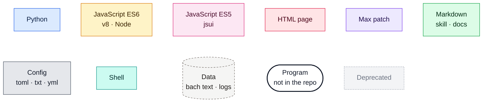
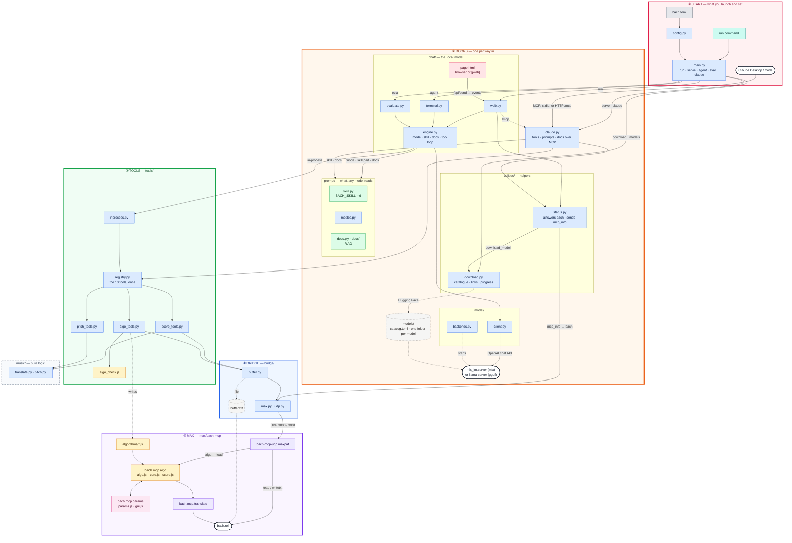

# File map

Every file in the project, what it does, and how the files connect. There are
two ways in, and both reach the same 13 tools:

- **Claude** (Claude Desktop, Claude Code) launches `main.py serve --stdio`
  itself, or joins a running Bach at `/mcp`, and calls the tools over MCP.
- **A local model** (MLX or GGUF, kept in `models/`): `run.command` starts the
  model server, the bridge to Max and Bach's chat page (in a browser, or in
  Max's `[jweb]`).

Whichever door is open, Max can ask Bach about itself over UDP (`bach
status`, `settings`, `models`, `catalog`), have it download a model
(`bach download_model <name> use`, with its progress), and Bach tells Max
what matters (`mcp_info ...`: no model, loading, ready, off). These helpers are
in `utilities/`: they help around Bach, they don't do its work.

**One rule orders the code:** each folder has one purpose, and a module only
imports from its own level or below. Levels go from what you launch (①) down to
Max (⑤); `music/` is the base anyone may use. Colours mark the language of each
file.

## How it runs

**A message to the local model:** the page posts it to `/api/send` →
`engine.py` takes the `/score` or `/algo` prefix, appends the instrument docs,
and sends the conversation with the mode's skill part and tools through
`client.py` → the model streams its answer and tool calls back → the engine
runs each tool in-process and returns its answer to the model, until it
answers without a tool call. Every step reaches the page as an event.

**A score write:** `write_score` → `music/translate.py` (JSON to llll) →
`buffer.py` writes `buffer.txt` → UDP `mcp_buffer_written` → the patch sends
`read` to bach.roll.

**An algorithm:** `send_algorithm` → Node check → `algorithms/<name>.js` →
UDP `algo <runner> load <path>` → `bach.mcp.algo` runs it →
`bach.mcp.translate` → bach.roll. Its parameters become a panel.

## Every file in the repository

```mermaid
flowchart LR
  root["bach-mcp/"]:::dir
  root --> rmd["README.md<br/>filemap.md"]:::md
  root --> rtoml["① bach.toml"]:::cfg
  root --> rcmd["① run.command"]:::sh
  root --> renv["① environment.yml<br/>requirements.in<br/>requirements.txt"]:::cfg
  root --> rgit[".gitignore<br/>.gitattributes"]:::cfg
  root --> modelsdir["models/"]:::dir
  modelsdir --> mreadme["README.md"]:::md
  modelsdir --> mcatalog["catalog.toml"]:::cfg
  modelsdir --> mfolders[("one folder per model<br/>not in git")]:::data
  root --> py["py/"]:::dir
  root --> mx["max/bach-mcp/"]:::dir
  root --> dep["deprecated/"]:::dir
  root --> logs["logs/ — not in git"]:::dir

  py --> mainpy["① main.py"]:::py
  py --> pkg["bach_mcp/<br/>__init__.py · ① config.py<br/>② claude.py"]:::py
  py --> tests["tests/"]:::dir
  pkg --> chatdir["② chat/<br/>__init__.py · engine.py · web.py<br/>terminal.py · evaluate.py"]:::py
  pkg --> chatpage["② chat/page.html"]:::html
  pkg --> modeldir["② model/<br/>__init__.py · backends.py · client.py"]:::py
  pkg --> utildir["utilities/<br/>__init__.py · status.py · download.py"]:::py
  pkg --> promptdir["② prompt/<br/>__init__.py · skill.py · modes.py · docs.py"]:::py
  pkg --> pskill["② prompt/BACH_SKILL.md"]:::md
  pkg --> docsdir["② prompt/docs/"]:::dir
  docsdir --> dreadme["README.md"]:::md
  docsdir --> dstr["strings/<br/>_family · violin · viola<br/>cello · double-bass"]:::md
  docsdir --> dww["woodwinds/<br/>_family · piccolo · flute · alto-flute<br/>oboe · english-horn · clarinet<br/>eb-clarinet · bass-clarinet<br/>bassoon · contrabassoon"]:::md
  docsdir --> dkb["keyboards/<br/>piano"]:::md
  pkg --> toolsdir["③ tools/<br/>__init__.py · registry.py · inprocess.py<br/>score_tools.py · pitch_tools.py<br/>algo_tools.py · session.py"]:::py
  pkg --> pcheck["③ tools/algo_check.js"]:::js
  pkg --> bridgedir["④ bridge/<br/>__init__.py · max.py · udp.py · buffer.py"]:::py
  pkg --> musicdir["music/<br/>__init__.py · translate.py · pitch.py"]:::py
  tests --> tpy["test_config · test_model · test_models · test_status<br/>test_chat · test_claude · test_modes · test_docs<br/>test_pitch · test_translate · test_buffer · test_algo<br/>test_evaluate · test_session · fakemodel.py"]:::py
  tests --> tjs["js/<br/>core.test.js · objects.test.js<br/>params.test.js · maxmock.js"]:::js

  mx --> pat["⑤ patchers/<br/>bach-mcp-udp · bach-mcp-udp-danielle<br/>bach.mcp.algo · bach.mcp.translate"]:::maxp
  mx --> jsv8["⑤ javascript/ — v8<br/>bach.mcp.algo · bach.mcp.core<br/>bach.mcp.score · bach.mcp.translate"]:::js
  mx --> jsui["⑤ javascript/ — jsui<br/>bach.mcp.params · bach.mcp.gui"]:::jsui
  mx --> alg["⑤ algorithms/"]:::dir
  alg --> aw["remove-flats.js"]:::js
  alg --> aws[("remove-flats.source.txt")]:::data
  alg --> aex["examples/<br/>drift · cells · transpose-phrases"]:::js
  alg --> atmp["temp/<br/>phrase-rotate · phrase-transpose<br/>segment-groups · weave"]:::js
  alg --> atmps[("temp/<br/>phrase-rotate.source.txt<br/>phrase-transpose.source.txt")]:::data
  alg --> ahist[(".history/ — not in git")]:::data
  mx --> rolls[("⑤ rolls/<br/>transpose_phrases.txt")]:::data
  mx --> buft[("④ buffer.txt — not in git")]:::data

  dep --> dreadme2["README.md"]:::md
  dep --> dpy["py/bach_mcp/<br/>mcp_app_full.py · gateway.py · compose.py · tcp.py<br/>llm/ __init__ · provider · openai_compat<br/>BACH_SKILL_LLLL.md · bach_score_schema.json<br/>assets/screenshots/score_20260930_145439.png<br/>py/tests/test_compose.py · test_gateway.py"]:::dep
  dep --> dmx["max/bach-mcp/<br/>bach-mcp.maxpat · bachTCP.js<br/>claude_desktop_config.json"]:::dep
  logs --> lg[("model-server.log<br/>eval-*.json")]:::data

  classDef dir fill:#fafafa,stroke:#a1a1aa,color:#18181b
  classDef py fill:#dbeafe,stroke:#2563eb,color:#0b1f44
  classDef js fill:#fef3c7,stroke:#d97706,color:#3b2300
  classDef jsui fill:#fce7f3,stroke:#db2777,color:#4a0a2a
  classDef html fill:#ffe4e6,stroke:#e11d48,color:#4c0519
  classDef maxp fill:#ede9fe,stroke:#7c3aed,color:#1e0b4b
  classDef md fill:#dcfce7,stroke:#16a34a,color:#052e16
  classDef cfg fill:#e5e7eb,stroke:#4b5563,color:#111827
  classDef sh fill:#ccfbf1,stroke:#0d9488,color:#042f2e
  classDef data fill:#f5f5f4,stroke:#78716c,stroke-dasharray:4 3,color:#1c1917
  classDef dep fill:#f3f4f6,stroke:#9ca3af,stroke-dasharray:2 2,color:#6b7280
```

## Files

Level: ① start · ② doors · ③ tools · ④ bridge · ⑤ Max · base: music · helper: utilities · — repository.

### Root

| file | language | level | role |
|---|---|---|---|
| `README.md` | Markdown | — | Setup and usage. |
| `filemap.md` | Markdown | — | This map. |
| `models/README.md` | Markdown | ② | How to fill `models/`. The models themselves (one folder each, many GB) are not in git. |
| `models/catalog.toml` | TOML | ② | Models known by name: repo, format, size, a note. Add your own. |
| `bach.toml` | TOML | ① | The only settings file: model, generation, chat, server, Max ports, algorithms (21 keys; the runtime follows from the model). |
| `run.command` | zsh | ① | Double-click to start the local model: finds the conda Python, runs `main.py run`. |
| `environment.yml` | YAML | ① | The conda env: Python 3.11. |
| `requirements.in` | text | ① | Direct dependencies: `mcp`, `httpx`, `mlx-lm` (Apple Silicon), `huggingface-hub`. |
| `requirements.txt` | text | ① | Pinned versions for pip, made by `pip-compile` from `requirements.in`. |
| `.gitignore` | git | — | Ignores caches, `logs/`, `buffer.txt`, `algorithms/.history/`, the models in `models/`. |
| `.gitattributes` | git | — | Line-ending normalisation. |

### Start (`py/`, `py/bach_mcp/`)

| file | language | level | role |
|---|---|---|---|
| `main.py` | Python | ① | The command line, nothing else: `run`, `serve` (`--stdio`), `agent`, `eval`, `claude`, `download`, `models`. |
| `bach_mcp/__init__.py` | Python | ① | The package map and its import rule. |
| `bach_mcp/config.py` | Python | ① | `bach.toml` → one `Config`, read once and passed down. Rejects unknown keys. Finds `[model] model` (a folder in `models/`, a path, or a repo), reads its runtime from it (`.safetensors` → mlx, `.gguf` → gguf), and checks it only when a model starts, saying what to do. |

### Door for the local model (`py/bach_mcp/chat/`)

| file | language | level | role |
|---|---|---|---|
| `__init__.py` | Python | ② | What the package holds. |
| `engine.py` | Python | ② | One conversation: the mode, the skill part, the docs, the tool loop. Reports each step as an event. Used by all three below. |
| `web.py` | Python | ② | `run`: starts the model and the bridge, serves the page, its event stream and `/mcp` on one port; Stop and New chat. On quit it closes the page's tabs in Chrome and Safari. |
| `page.html` | HTML | ② | The chat page, self-contained: in a browser, or in Max's `[jweb]` (inlet `send`, `new`; outlet `mode`, `tool`, `done`, `off`). Closes itself when Bach goes off. |
| `terminal.py` | Python | ② | `agent`: the same conversation in the terminal. |
| `evaluate.py` | Python | ② | `eval`: fixed requests through the engine, several runs, automatic checks; results in `logs/eval-*.json`. |

### Door for Claude (`py/bach_mcp/claude.py`)

| file | language | level | role |
|---|---|---|---|
| `claude.py` | Python | ② | The tools over MCP (stdio or HTTP), with the skill as instructions, `/score` and `/algo` as prompts, the instrument docs as resources. `register_desktop()` and the Claude Code lines for `main.py claude`. |

### Helpers (`py/bach_mcp/utilities/`)

| file | language | level | role |
|---|---|---|---|
| `__init__.py` | Python | helper | What the package holds. |
| `status.py` | Python | helper | What Bach tells Max: answers `bach status`, `settings`, `models`, `catalog`, `download_model`, `download_stop`, `quit`, `help`, `ping` with `mcp_info` lines, always `mcp_info <what it is> <value>` (e.g. `mcp_info state ready`, `mcp_info generation.temperature 0.7`, `mcp_info download_progress 37`). Unasked it sends only `mcp_info status 1` once Bach has started and `mcp_info status 0` as its last message (plus download progress, and the warning from a second Bach). Also the page's state. Used by every door. |
| `download.py` | Python | helper | Models into `models/<name>/`: by a catalogue name, a Hugging Face repo (MLX whole, GGUF one quantization) or a link. `DownloadJob` runs a download in its own process and reports its progress; `--use` sets it in `bach.toml`. |

### The local model (`py/bach_mcp/model/`)

| file | language | level | role |
|---|---|---|---|
| `__init__.py` | Python | ② | What the package holds. |
| `backends.py` | Python | ② | Starts and stops the model server: `mlx_lm.server` (mlx) or `llama-server` (gguf), on an internal port. Log in `logs/model-server.log`. |
| `client.py` | Python | ② | The one client: a streaming chat request with tools, in the OpenAI format both servers speak. Sampling and reasoning from `[generation]`. Stop closes the stream. |

### What any model reads (`py/bach_mcp/prompt/`)

| file | language | level | role |
|---|---|---|---|
| `__init__.py` | Python | ② | What the package holds. |
| `skill.py` | Python | ② | Reads the skill and cuts out each mode's part (`<!-- algo -->`, `<!-- score -->`, `<!-- both -->`). |
| `BACH_SKILL.md` | Markdown | ② | The skill: the local model's system prompt, Claude's MCP instructions. |
| `modes.py` | Python | ② | `/score` and `/algo`: the prefixes and the tools of each mode. |
| `docs.py` | Python | ② | RAG: finds the instruments a message names (whole words, longest alias first) and appends their files, once per conversation. |
| `docs/README.md` | Markdown | ② | The format of a doc: front matter (`aliases`, `family`), sounding pitch in midicents, JSON spellings the translator accepts. |
| `docs/strings/` | Markdown | ② | `_family.md`, `violin.md`, `viola.md`, `cello.md`, `double-bass.md`. |
| `docs/woodwinds/` | Markdown | ② | `_family.md`, `piccolo.md`, `flute.md`, `alto-flute.md`, `oboe.md`, `english-horn.md`, `clarinet.md`, `eb-clarinet.md`, `bass-clarinet.md`, `bassoon.md`, `contrabassoon.md`. |
| `docs/keyboards/` | Markdown | ② | `piano.md`. |

### The tools (`py/bach_mcp/tools/`)

| file | language | level | role |
|---|---|---|---|
| `__init__.py` | Python | ③ | What the package holds. |
| `registry.py` | Python | ③ | `create_tools()`: the one MCP app with the 13 tools; logs every call. Both doors use it. |
| `inprocess.py` | Python | ③ | The same tools, called directly by the local chat (specs in the OpenAI format, `call()`). |
| `score_tools.py` | Python | ③ | `write_score`, `read_score`, `clear_score`. |
| `pitch_tools.py` | Python | ③ | The 9 pitch tools (`p2mc`, `get_chord`, `transpose`, …). |
| `algo_tools.py` | Python | ③ | `send_algorithm`: check, save to `algorithms/` (old version to `.history/`), load in Max. |
| `algo_check.js` | JS ES6 (Node) | ③ | Runs an algorithm with `bach.mcp.core.js` at its declared values and every parameter edge. |
| `session.py` | Python | ③ | Which conversation the tools serve, so `read_score` forgets between chats. |

### The bridge to Max (`py/bach_mcp/bridge/`)

| file | language | level | role |
|---|---|---|---|
| `__init__.py` | Python | ④ | What the package holds. |
| `max.py` | Python | ④ | `MaxBridge`: `send(line)`, `say(*words)`, `receive(timeout)`, `flush()`; `bach` lines from the patch go to `on_request`, never to `receive`. Says when another Bach holds the port; `utilities/status.py` then warns Max and does not start. `OfflineBridge` for eval. |
| `udp.py` | Python | ④ | Lines of text ↔ the UDP packets `[udpreceive]` reads. |
| `buffer.py` | Python | ④ | Scores travel through `buffer.txt`. Inserts chords into bach's own text for `add=True`. |

### Music logic (`py/bach_mcp/music/`)

| file | language | level | role |
|---|---|---|---|
| `__init__.py` | Python | base | What the package holds. |
| `translate.py` | Python | base | JSON ↔ llll, deterministic, no I/O. |
| `pitch.py` | Python | base | Pitch arithmetic and the chord and scale library. |

### Tests (`py/tests/`)

`python -m unittest discover -s py/tests` runs all of them, the JavaScript ones
too. None needs Max or a model.

| file | language | what it tests |
|---|---|---|
| `test_config.py` | Python | `bach.toml`: accepted values, refused mistakes, when the model settings are checked. |
| `test_model.py` | Python | The backends' command lines; reading a streamed reply; the client against a live server, and Stop. |
| `test_chat.py` | Python | The engine (modes, docs, tool loop, retries, limits) and the web app, with and without a model. |
| `test_models.py` | Python | `models/`: recognising MLX and GGUF, finding the model `bach.toml` names, naming a model (catalogue, repo, link), choosing GGUF files, the download job (progress, done, failure, stop), `--use`. |
| `test_status.py` | Python | The answers to `bach`, the notices, `download_model` from start to done, and a real UDP round trip Max → Bach → Max. |
| `test_claude.py` | Python | What Claude gets (tools, prompts, docs) and registering in Claude Desktop and Claude Code. |
| `test_modes.py` | Python | Prefixes, skill parts, the tools of each mode. |
| `test_docs.py` | Python | Every instrument doc: fields, ranges, clefs, JSON spellings. |
| `test_pitch.py` | Python | Pitch functions and the pitch tools' answers. |
| `test_translate.py` | Python | `translate.py`, and the JSON examples in the skill. |
| `test_buffer.py` | Python | `buffer.py` and the score tools, against a stand-in bach.roll. |
| `test_algo.py` | Python | `send_algorithm`, the examples, the JS translator against `translate.py`. Runs the JS tests. |
| `test_evaluate.py` | Python | The eval checks, on hand-written scores. |
| `test_session.py` | Python | The conversation counter. |
| `fakemodel.py` | Python | A stand-in model server: scripted replies in the OpenAI stream format. |
| `js/core.test.js` | JS ES6 (Node) | The algorithm library and loader. |
| `js/objects.test.js` | JS ES6 (Node) | `bach.mcp.algo` and `bach.mcp.translate`. |
| `js/params.test.js` | JS ES6 (Node) | The panel and its widgets. |
| `js/maxmock.js` | JS ES6 (Node) | A stand-in for Max's JavaScript (v8 and jsui). |

### Max package (`max/bach-mcp/`)

| file | language | level | role |
|---|---|---|---|
| `patchers/bach-mcp-udp.maxpat` | Max | ⑤ | Main patch: UDP bridge, buffer read/write, bach.roll, two runners with panels. |
| `patchers/bach-mcp-udp-danielle.maxpat` | Max | ⑤ | Working patch with three runners. |
| `patchers/bach.mcp.algo.maxpat` | Max | ⑤ | Runner abstraction: v8 runner, translator, and (since 10-22) its own UDP bridge. |
| `patchers/bach.mcp.translate.maxpat` | Max | ⑤ | Translator abstraction (`@in json\|bach @out bach\|json`). |
| `javascript/bach.mcp.algo.js` | JS ES6 (v8) | ⑤ | The runner: loads, runs and reloads an algorithm, keeps a transformer's source. |
| `javascript/bach.mcp.core.js` | JS ES6 (v8, Node) | ⑤ | The library every algorithm sees, plus the loader. |
| `javascript/bach.mcp.score.js` | JS ES6 (v8, Node) | ⑤ | JSON ↔ llll, a port of `translate.py`. |
| `javascript/bach.mcp.translate.js` | JS ES6 (v8) | ⑤ | The script of `bach.mcp.translate`. |
| `javascript/bach.mcp.params.js` | JS ES5 (jsui) | ⑤ | The panel. |
| `javascript/bach.mcp.gui.js` | JS ES5 (jsui) | ⑤ | The panel's widget library. |
| `algorithms/remove-flats.js` | JS ES6 | ⑤ | The current transformer. |
| `algorithms/remove-flats.source.txt` | bach text | ⑤ | Its source score. |
| `algorithms/examples/drift.js` | JS ES6 | ⑤ | Producer; the skill's first example. |
| `algorithms/examples/cells.js` | JS ES6 | ⑤ | Producer (older `generate` form). |
| `algorithms/examples/transpose-phrases.js` | JS ES6 | ⑤ | Transformer; the skill's second example. |
| `algorithms/temp/phrase-rotate.js`, `phrase-transpose.js` | JS ES6 | ⑤ | Older transformers, each with its `.source.txt`. |
| `algorithms/temp/segment-groups.js`, `weave.js` | JS ES6 | ⑤ | Older producers. |
| `algorithms/.history/` | JS ES6 | ⑤ | Earlier versions, kept by `send_algorithm` (not in git). |
| `rolls/transpose_phrases.txt` | bach text | ⑤ | Test roll, 893 notes. |
| `buffer.txt` | bach text | ④ | The score exchange file (not in git). |

### Not in use, or not in git

| path | role |
|---|---|
| `deprecated/` | Obsolete files, at their original paths. Listed in [`deprecated/README.md`](deprecated/README.md). |
| `models/<name>/` | The downloaded models. |
| `logs/model-server.log` | What the model server prints. |
| `logs/eval-*.json` | One file per `main.py eval` run. |

## Defects still open (2026-10-24)

These are in the Max patch and come with step 2 (named runners):

1. **`clear`, `tonedivision` and `mcp_info` never arrive.** In all three
   patches, `[route algo mcp_buffer_written write_buffer]` leaves its last
   outlet unconnected. `clear_score` still answers "Score cleared.", and
   Bach's status lines are dropped until `mcp_info` is added to that route.
2. **`send_algorithm` never gets its confirmation.** `algo_status` goes to
   `[s bach.mcp.tcp]`, which nothing receives since the Node bridge left.
   Every call waits 6 s, then reports "Max did not confirm".
3. **The bridge is in two places, and runners have no names.** `udpreceive
   3000`, `write_and_check` and `udpsend 3001` are in the main patch *and* in
   every `bach.mcp.algo`. Every runner is called `algo`, so all of them load
   every algorithm.
4. **One Bach at a time.** Each Bach holds UDP 3001. A second Bach does not
   start: it warns Max (`mcp_info notice "Another bach server is already
   running"`) and exits; the first keeps going. Running several together would
   need Max to answer on the port the request came from; that touches the
   patch, so it belongs with step 2.

## Optimisation zones: where they stand

| zone | status |
|---|---|
| **A. One door to the model** | Done. The page, the terminal and eval all use `chat/engine.py`; `model/client.py` is the only code that talks to a model. |
| **B. MLX instead of Ollama** | Done in code: `[model] backend = "mlx"` or `"gguf"`. The Ollama translator, model checks and start-up are gone. To use: set `[model] model` to an MLX copy of the model. |
| **C. Our own chat page** | Done: `chat/page.html`, served by Bach, ready for `[jweb]`. llama-server is no longer needed except for GGUF models. |
| **D. One bridge owner** | Partly: Claude Code can join the running Bach at `/mcp`, and a busy port gives a clear message. The rest is defect 4. |
| **E. Claude gets the same content** | Done: `/score` and `/algo` as MCP prompts, the instrument docs as resources. |
| **F. Register Claude with one command** | Done: `python py/main.py claude`. |
| **G. One settings channel** | Done: 22 settings, read once and passed down; no `BACH_*` environment variables; Claude never depends on `[model]`. |
