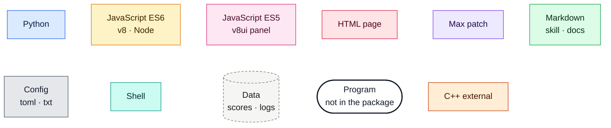
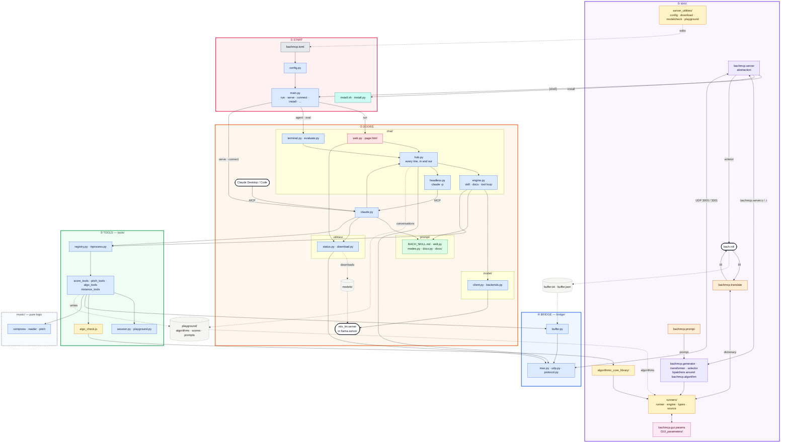

# File map

Every file in the package, what it does, and how the files connect. The repository is itself the Max package: put the folder in `Max 9/Packages/` and Max finds everything.

There are two ways in, and both reach the same tools (15: 13 for composing, and 2 that let a Claude written to directly list the instances and choose one):

- **A local model** (MLX or GGUF, kept in `models/`): `[bachmcp.server local]` runs `main.py run`, which starts the model server, the bridge to Max and the chat page. Instances in Max send it prompts.
- **Claude**: `[bachmcp.server claude]` runs `main.py serve`, which serves the tools over MCP. Instances in Max send it prompts, each answered by a `claude -p` on the user's account. You can also write in Claude Desktop (which launches `main.py connect` to pass its calls on) or Claude Code, for the active instance.

Every message between the parts is listed in [`cmdmap.md`](cmdmap.md).

**One rule orders the Python code:** each folder has one purpose, and a module only imports from its own level or below. Levels go from what you launch (①) down to Max (⑤); `music/` is the base anyone may use.

## How it runs

**A prompt to the local model:** `bachmcp.prompt` → the instance sends `<name> prompt <text>` → `hub.py` queues it → `engine.py` adds the skill for the instance's type and any instrument docs, and sends the conversation through `client.py` → the model streams its answer and tool calls back → the engine runs each tool in-process and returns the result, until the model answers without a tool call. Every step goes out as a line, to Max and the page.

**A prompt to Claude:** the same up to `hub.py`, then `headless.py` starts `claude -p` with the instance's part of the skill and its tools only (served apart, at `/mcp/headless/<mode>`). Claude calls them over MCP from this same Bach, and the hub says which instance they serve. The next prompt resumes the session.

**An algorithm:** `send_algorithm` → checked in Node (`algo_check.js`) with the same library Max uses → saved as `playground/algorithms/<name>.js` → UDP `<name> load_algo <name>.js` → the instance's runner loads and runs it → its score leaves as a dictionary → `bachmcp.translate` → `bach.roll`. Its parameters become the panel, and moving one runs the algorithm again.

**Reading the roll:** `read_score` → UDP `server write_buffer` → `bachmcp.server` tells the roll to `writetxt` `buffer.txt`, converts it to `buffer.json` → `server buffer_done` → `music/reader.py` shows it to the model in the compressed form.

## Files

Level: ① start · ② doors · ③ tools · ④ bridge · ⑤ Max · base: music · helper: utilities · — package.

### Root

| file | language | level | role |
|---|---|---|---|
| `README.md` | Markdown | — | Requirements, installation, basic features. |
| `filemap.md` | Markdown | — | This map. |
| `cmdmap.md` | Markdown | — | Every message between Max, Python, the page and Claude. |
| `bachjson-syntax-specification.md` | Markdown | — | bachjson-complete, the lossless JSON of bach's syntax used between objects. |
| `bachmcp.toml` | TOML | ① | The only settings file: model, generation, chat, server, Max ports, Node. `bachmcp.server` writes its attributes here. |
| `package-info.json` | JSON | ⑤ | The Max package: name, version, minimum Max version. |
| `requirements.txt` | text | ① | Pinned packages every installation gets. Read by `install.py`. |
| `requirements-local.txt` | text | ① | Pinned packages the local model adds (MLX, Hugging Face). Read by `install.py`. |
| `requirements.in`, `requirements-local.in` | text | — | The direct dependencies and why. Not read at runtime: `pip-compile` makes the `.txt` files from them (the command is at the top of each `.txt`). |
| `buffer.txt`, `buffer.json` | bach text, JSON | ④ | The score of the roll, on its way to `read_score`. Rewritten on every read; not in git. |
| `.gitignore`, `.gitattributes` | git | — | What git ignores (models, caches, logs, buffers), line-ending normalisation. |

### Max: objects (`patchers/`, `clippings/`, `externals/`, `init/`, `interfaces/`)

The patches were not opened for this map: what is said of them comes from the JavaScript they load and from their names.

| file | language | level | role |
|---|---|---|---|
| `patchers/bachmcp.server.maxpat` | Max | ⑤ | The server: writes `bachmcp.toml`, runs Python through `[shell]`, holds the UDP objects, sends the instance map, the playground and the models. |
| `patchers/bachmcp.algorithm.maxpat` | Max | ⑤ | An instance of any type, around `[v8 bachmcp.runner.js <type>]`: its name in the map, its prompts. It replaced `bachmcp.algo.generate`, `.transform` and `.select`. |
| `patchers/bachmcp.bpatcher.algorithm.maxpat` | Max | ⑤ | An instance with its panel, as a bpatcher: `@args <name> <type>`. It replaced the three `bachmcp.bpatcher.<type>`. |
| `patchers/bachmcp.generator.maxpat`, `bachmcp.transformer.maxpat`, `bachmcp.selector.maxpat` | Max | ⑤ | Typed in a box, each replaces itself with `bachmcp.bpatcher.algorithm` of its type (`bachmcp.bpatcher.replace.js`). |
| `patchers/bachmcp.chat.maxpat` | Max | ⑤ | The chat inside Max (tutorial 6). |
| `patchers/bachmcp.score.maxpat` | Max | ⑤ | New, not in git yet. |
| `clippings/bachmcp.ui.generator.maxpat`, `.transformer.maxpat`, `.selector.maxpat` | Max | ⑤ | Clippings: an instance of each type, ready to paste. |
| `externals/bachmcp.translate.mxo` | C++ | ⑤ | bach.roll's llll ↔ bachjson-complete dictionary, lossless. Built from `sources/`. |
| `externals/bachmcp.prompt.mxo` | C++ | ⑤ | The prompt box. Built from `sources/`. |
| `init/bachmcp-objectlist.txt` | Max | ⑤ | The objects Max lists as `bachmcp`. |
| `init/bachmcp-objectmappings.txt` | Max | ⑤ | `[bachmcp.gui.params]` is a `[v8ui bachmcp.gui.params.v8ui.js]`. |
| `interfaces/bachmcp-obj-qlookup.json` | JSON | ⑤ | Max's object lookup entries for the package. It still has `bachmcp.algo.*`. |

### Max: help and documentation (`help/`, `docs/`, `extras/`, `examples/`)

| file | language | level | role |
|---|---|---|---|
| `help/bachmcp.<object>.maxhelp` | Max | ⑤ | One help patch per object. The ones for `bachmcp.algo.*` and `bachmcp.bpatcher.<type>` are of objects that no longer exist; `bachmcp.algorithm`, `bachmcp.bpatcher.algorithm` and `bachmcp.chat` have none. |
| `docs/refpages/bachmcp-ref/bachmcp.<object>.maxref.xml` | XML | ⑤ | One reference page per object, with the same gaps as `help/`. |
| `extras/bachmcp/1-installation.maxpat` | Max | ⑤ | Tutorial: the installation. |
| `extras/bachmcp/2-downloading a model.maxpat` | Max | ⑤ | Tutorial: the catalog and downloading a model. |
| `extras/bachmcp/3-testing local.maxpat` | Max | ⑤ | Tutorial: a first test with the local model. |
| `extras/bachmcp/4-testing claude.maxpat` | Max | ⑤ | Tutorial: a first test with Claude. |
| `extras/bachmcp/5-operating on selection.maxpat` | Max | ⑤ | Tutorial: selectors, and working only on the selected notes. |
| `extras/bachmcp/6-using the chat.maxpat` | Max | ⑤ | Tutorial: the chat. |
| `examples/example-1.maxpat`, `example-2.maxpat` | Max | ⑤ | Working examples of objects connected together. |

### Max: runners (`javascript/runners/`)

One `[v8 bachmcp.runner.js <type>]` inside each `bachmcp.algorithm`: the same script for every type. The loader and the parameters also run in Node, for the check before a file reaches Max.

| file | language | level | role |
|---|---|---|---|
| `bachmcp.runner.js` | JS ES6 (v8) | ⑤ | What Max sees: the inlet's messages and the five outlets, the same for every type. `type <t>` changes what it is. Its header lists every message. |
| `bachmcp.runner.engine.js` | JS ES6 (v8, Node) | ⑤ | What every type does: load, check the kind, parameters, settings, panel, bang / run / repeat, snap, bypass, watch the file, report. |
| `bachmcp.runner.type.generator.js` | JS ES6 (v8, Node) | ⑤ | The generator type: `function produce(p)`. |
| `bachmcp.runner.type.transformer.js` | JS ES6 (v8, Node) | ⑤ | The transformer type: `function transform(source, p)`; with `process_only_selection 1`, puts the other notes back. |
| `bachmcp.runner.type.selector.js` | JS ES6 (v8, Node) | ⑤ | The selector type: `function select(source, p)`; flags the selection in the score and sends it to the roll. |
| `bachmcp.runner.source.js` | JS ES6 (v8, Node) | ⑤ | The source a transformer and a selector share: asking the roll for it, waiting, the two source modes, `capture`. |
| `bachmcp.runner.selection.js` | JS ES6 (v8, Node) | ⑤ | The selection as bach's flag 16: splitting a score into selected and rest, merging, marking. |
| `bachmcp.runner.loader.js` | JS ES6 (v8, Node) | ⑤ | Loads and runs an algorithm file with the library in scope. |
| `bachmcp.runner.paramspec.js` | JS ES6 (v8, Node) | ⑤ | An algorithm's parameter declarations: completed, checked and coerced. |
| `bachmcp.runner.files.js` | JS ES6 (v8) | ⑤ | Text files through Max's `File` object. |

### Max: the library algorithms see (`javascript/algorithmic_core_library/`)

Everything here is in scope in an algorithm file, without imports, in Max and in Node.

| file | language | level | role |
|---|---|---|---|
| `bachmcp.lib.index.js` | JS ES6 | ⑤ | The one list of the library. To add a topic: a file here, its entry in `TOPICS`, the skill, a test. |
| `bachmcp.lib.base.js` | JS ES6 | ⑤ | The error an algorithm's author reads, and two checks. Not in scope. |
| `bachmcp.lib.units.js` | JS ES6 | ⑤ | Units and pitch names: `pitch("Db4")`, `name(6100)`. |
| `bachmcp.lib.build.js` | JS ES6 | ⑤ | Making and handling scores: `score()`, voices, notes, chords, `copy`, `eachNote`. |
| `bachmcp.lib.random.js` | JS ES6 | ⑤ | Seeded randomness: `rng(name)`, and a seeded `Math.random`. |
| `bachmcp.lib.numbers.js` | JS ES6 | ⑤ | Interpolation, ranges, sequences, breakpoint functions. |
| `bachmcp.lib.procedures.js` | JS ES6 | ⑤ | Iteration, random walks, Markov chains, L-systems, cellular automata, Euclidean rhythms. |
| `bachmcp.lib.gather.js` | JS ES6 | ⑤ | Chords, notes and pitches in time order, a span, a time window. |
| `bachmcp.lib.segments.js` | JS ES6 | ⑤ | Phrases cut at silences, sections cut at markers. |
| `bachmcp.lib.lines.js` | JS ES6 | ⑤ | Melodic lines: intervals, contour, turns, rhythm. |
| `bachmcp.lib.harmony.js` | JS ES6 | ⑤ | Pitch classes, set classes, the harmonic field. |
| `bachmcp.lib.texture.js` | JS ES6 | ⑤ | Ambitus, centre, and how density, register or loudness change over time. |
| `bachmcp.lib.likeness.js` | JS ES6 | ⑤ | Comparing passages: features, similarity, classifying. |

### Max: the interface (`javascript/GUI_parameters/`)

| file | language | level | role |
|---|---|---|---|
| `bachmcp.gui.params.v8ui.js` | JS ES6 (v8ui) | ⑤ | The parameter panel: the script of `bachmcp.gui.params`. |
| `bachmcp.gui.params.panel.js` | JS ES5 | ⑤ | The panel's layout, gestures and saved state. |
| `bachmcp.gui.params.elements.js` | JS ES5 | ⑤ | One element per parameter type: slider, range, toggle, menu, seed, curve, list. |
| `bachmcp.gui.params.base.js` | JS ES5 | ⑤ | The panel's theme, numbers and drawing helpers. |
| `bachmcp.gui.resize.js` | JS ES5 | ⑤ | Inside a bpatcher: reports its box's `patching_rect` and `presentation_rect`, at load and when they change. |
| `bachmcp.prompt.v8ui.js` | JS ES6 (v8ui) | ⑤ | An earlier prompt box in JavaScript. `bachmcp.prompt`, the external, does this job; no script or test uses this file. |

### Max: server utilities (`javascript/server_utilities/`)

| file | language | level | role |
|---|---|---|---|
| `bachmcp.server.config.js` | JS (Node for Max) | ⑤ | Writes `bachmcp.server`'s attributes to `bachmcp.toml`, keeping its comments. |
| `bachmcp.server.download.js` | JS (Node for Max) | ⑤ | Downloads a model into `models/`, and lists the catalog. |
| `bachmcp.server.modelcheck.js` | JS (Node for Max) | ⑤ | Says whether the model named by `@model` is there. |
| `bachmcp.server.playground.js` | JS (Node for Max) | ⑤ | Makes sure the playground and its folders exist. |
| `bachmcp.bpatcher.replace.js` | JS ES6 (v8) | ⑤ | Replaces a typed `[bachmcp.generator t1]` with `[bpatcher @name bachmcp.bpatcher.algorithm @args t1 generator]`. |

### Python: start (`py/`, `py/bach_mcp/`)

| file | language | level | role |
|---|---|---|---|
| `py/install.sh` | sh | ① | Finds a Python 3.11+ and runs the installer with it. What `install` on `bachmcp.server` runs. |
| `py/main.py` | Python | ① | The command line: `run`, `serve` (`--stdio`), `connect`, `install`, `agent`, `eval`, `claude`, `download`, `models`. |
| `bach_mcp/__init__.py` | Python | ① | The package map and its import rule. |
| `bach_mcp/config.py` | Python | ① | `bachmcp.toml` → one `Config`, read once and passed down. Finds the model and its runtime. |
| `bach_mcp/install.py` | Python | ① | Makes the `.venv`, installs the requirements, finds Node, registers Claude, checks Claude Code's login. |

### Python: door for the local model (`bach_mcp/chat/`)

| file | language | level | role |
|---|---|---|---|
| `__init__.py` | Python | ② | What the package holds. |
| `hub.py` | Python | ② | The centre: handles every line from Max, the page and the terminal, and sends every answer. Holds the playground, the instance map, the active instance and one conversation per instance. Its docstring is the source of truth for the protocol. |
| `engine.py` | Python | ② | One conversation: the mode, the skill part, the docs, the tool loop. Reports each step as an event. |
| `headless.py` | Python | ② | The same conversation with Claude, for `serve`: one `claude -p` per message, its stream turned into the engine's events. |
| `web.py` | Python | ② | `run`: starts the model and the bridge. `create_app`: the page and its event stream, also for `serve`, beside `/mcp`. |
| `page.html` | HTML | ② | The chat page: shows what the hub says and turns each action into a line. |
| `terminal.py` | Python | ② | `agent`: the same hub in the terminal. |
| `evaluate.py` | Python | ② | `eval`: fixed requests through the engine, automatic checks; results in `logs/eval-*.json`. |

### Python: door for Claude (`bach_mcp/claude.py`)

| file | language | level | role |
|---|---|---|---|
| `claude.py` | Python | ② | `serve` and `connect` (which hands Claude Desktop's calls on over one kept session): the tools over MCP at `/mcp`, with the skill as instructions, `/score` and `/algo` as prompts, the instrument docs as resources; and one app per mode at `/mcp/headless/<mode>` for the `claude -p` Bach starts. Finds Claude Code, checks its login, registers Bach in Claude Desktop and Claude Code. |

### Python: helpers (`bach_mcp/utilities/`)

| file | language | level | role |
|---|---|---|---|
| `__init__.py` | Python | helper | What the package holds. |
| `status.py` | Python | helper | What Bach tells Max about itself: answers `bach <request>` with `server ...` lines, `server status 1` and `0`, quitting on signals and closed input. |
| `download.py` | Python | helper | Models into `models/<name>/`: by catalog name, Hugging Face repo or link, with progress. |

### Python: the local model (`bach_mcp/model/`)

| file | language | level | role |
|---|---|---|---|
| `__init__.py` | Python | ② | What the package holds. |
| `backends.py` | Python | ② | Starts and stops the model server: `mlx_lm.server` or `llama-server`, on an internal port. Log in `logs/model-server.log`. |
| `client.py` | Python | ② | The one client: a streaming chat request with tools, in the OpenAI format both servers speak. |

### Python: what any model reads (`bach_mcp/prompt/`)

| file | language | level | role |
|---|---|---|---|
| `__init__.py` | Python | ② | What the package holds. |
| `BACH_SKILL.md` | Markdown | ② | The skill: the local model's system prompt, Claude's MCP instructions. |
| `skill.py` | Python | ② | Reads the skill and cuts out each mode's part. |
| `modes.py` | Python | ② | `/score` and `/algo`, and which mode and tools each instance type gets. |
| `docs.py` | Python | ② | Finds the instruments a message names and appends their files, once per conversation. |
| `docs/README.md` | Markdown | ② | The format of an instrument doc. |
| `docs/strings/` | Markdown | ② | `_family`, `violin`, `viola`, `cello`, `double-bass`. |
| `docs/woodwinds/` | Markdown | ② | `_family`, `piccolo`, `flute`, `alto-flute`, `oboe`, `english-horn`, `clarinet`, `eb-clarinet`, `bass-clarinet`, `bassoon`, `contrabassoon`. |
| `docs/keyboards/` | Markdown | ② | `piano`. |

### Python: the tools (`bach_mcp/tools/`)

| file | language | level | role |
|---|---|---|---|
| `__init__.py` | Python | ③ | What the package holds. |
| `registry.py` | Python | ③ | `create_tools()`: the one MCP app with the 15 tools, or only the named ones. Runs each call on a thread, one at a time; marks the calls of a Claude written to directly; logs every call. Both doors use it. |
| `inprocess.py` | Python | ③ | The same tools, called directly by the local chat. |
| `score_tools.py` | Python | ③ | `write_score`, `read_score`, `clear_score`. |
| `pitch_tools.py` | Python | ③ | The 9 pitch tools (`p2mc`, `get_chord`, `transpose`, …). |
| `algo_tools.py` | Python | ③ | `send_algorithm`: check, save (old version to `.history/`), load in Max. |
| `instance_tools.py` | Python | ③ | `get_instances`, `set_active_instance`: for a Claude written to directly. In no mode, so an instance's own conversation never gets them. |
| `algo_check.js` | JS ES6 (Node) | ③ | Runs an algorithm with the library at its declared values and every parameter edge. |
| `session.py` | Python | ③ | Which conversation and which instance the tools serve, and whether the caller is a Claude written to directly; the hub answers, and lists the instances. |
| `playground.py` | Python | ③ | The playground's folders, and Max paths read as system paths. |

### Python: left behind (`bach_mcp/assets/`)

| file | language | level | role |
|---|---|---|---|
| `assets/memory.json` | JSON | — | Notes of the old project-memory tool (now in `deprecated/`). Nothing reads it. |

### Python: the bridge to Max (`bach_mcp/bridge/`)

| file | language | level | role |
|---|---|---|---|
| `__init__.py` | Python | ④ | What the package holds. |
| `max.py` | Python | ④ | `MaxBridge`: sends and receives lines, routes them. Says when another Bach holds the port. `OfflineBridge` for eval and `connect`. |
| `udp.py` | Python | ④ | Lines of text ↔ the UDP packets `[udpreceive]` reads. |
| `protocol.py` | Python | ④ | The one form of every message: a line of words. |
| `buffer.py` | Python | ④ | Scores through files: `RollBuffer` for an instance's roll (a writer's), `ServerBuffer` for `buffer.json`. It reads `REPO_ROOT` from `config.py`, the one import that goes up a level. |

### Python: music logic (`bach_mcp/music/`)

| file | language | level | role |
|---|---|---|---|
| `__init__.py` | Python | base | What the package holds. |
| `compress.py` | Python | base | bachjson-complete ↔ the compressed form the model reads and writes. |
| `reader.py` | Python | base | What `read_score` shows: an overview and the music asked for. |
| `pitch.py` | Python | base | Pitch arithmetic and the chord and scale library. |

### Tests (`py/tests/`)

`.venv/bin/python -m unittest discover -s py/tests` runs all of them, the JavaScript ones too. None needs Max or a model.

| file | language | what it tests |
|---|---|---|
| `test_config.py` | Python | `bachmcp.toml`: accepted values, refused mistakes. |
| `test_install.py` | Python | The installer's arguments and the Node path; quitting on signals and closed input. |
| `test_hub.py` | Python | The line protocol, the playground, the instance map, the instance tools, the stages of a prompt, one conversation per instance, tools off the event loop, the web app. |
| `test_chat.py` | Python | The engine: modes, docs, tool loop, retries, limits. |
| `test_headless.py` | Python | Claude Code behind the hub, on a stand-in `claude`. |
| `test_model.py` | Python | The backends' command lines, streamed replies, the client against a live server. |
| `test_models.py` | Python | `models/`: recognising formats, naming a model, the download job, `--use`. |
| `test_status.py` | Python | The answers to `bach`, and a real UDP round trip Max → Bach → Max. |
| `test_claude.py` | Python | What Claude gets, registering in Claude Desktop and Claude Code, and `connect` against a real server: one session, a new one when Bach restarts. |
| `test_modes.py` | Python | Prefixes, skill parts, the tools of each mode. |
| `test_skill.py` | Python | The skill's examples are valid compressed scores. |
| `test_docs.py` | Python | Every instrument doc: fields, ranges, clefs, spellings. |
| `test_pitch.py` | Python | Pitch functions and the pitch tools' answers. |
| `test_compress.py` | Python | The compressed form of bachjson-complete. |
| `test_buffer.py` | Python | `buffer.py` and the score tools, against a stand-in roll. |
| `test_algo.py` | Python | `send_algorithm` and the examples. Runs the JavaScript tests. |
| `test_evaluate.py` | Python | The eval checks, on hand-written scores. |
| `test_session.py` | Python | The conversation counter. |
| `fakemodel.py` | Python | A stand-in model server: scripted replies in the OpenAI stream format. |
| `js/bachmcp.lib.<topic>.test.js` | JS (Node) | One test file per topic of the library. |
| `js/loader.test.js` | JS (Node) | Loading, checking and running an algorithm file. |
| `js/objects.test.js` | JS (Node) | The runner and its three types, on a stand-in for Max. |
| `js/panel_runner.test.js` | JS (Node) | The runner and the panel connected: a type change, `sync`, `get_specs`. |
| `js/reload.test.js` | JS (Node) | A file that changes on disk: reloading, and which values are kept. |
| `js/replace.test.js` | JS (Node) | `bachmcp.bpatcher.replace.js`. |
| `js/params.test.js` | JS (Node) | The parameter panel, on a stand-in for Max. |
| `js/config.test.js` | JS (Node) | `bachmcp.server.config.js`: editing `bachmcp.toml`. |
| `js/maxmock.js`, `js/fixtures.js` | JS (Node) | A stand-in for Max's JavaScript; the library and a small piece of music for the tests. |

### Made as it runs

| path | role |
|---|---|
| `.venv/` | The virtual environment, made by the installer. |
| `models/catalog.toml` | Models known by name: repo, format, size. Add your own. |
| `models/<name>/` | The downloaded models, one folder each. |
| `playground/` | Default folder for what the model makes: `algorithms/`, `scores/`, `prompts/`. |
| `logs/model-server.log` | What the model server prints. |
| `logs/eval-*.json` | One file per `main.py eval` run. |

### Kept apart from the package

| path | role |
|---|---|
| `sources/` | CMake projects of the two externals. Builds need bach's sources, read-only. |
| `deprecated/` | Files no longer used, at their original paths. See `deprecated/README.md`. |

## Not built yet

- **The writer.** Python knows the `writer` type and `write_score` and `clear_score` work for it, but no script answers `load_roll`, `write_roll`, `tonedivision` or `clear`. `patchers/bachmcp.score.maxpat` is new and was not opened for this map: it may be this.
- **Not tested:** `bachmcp.server.download.js`, `.modelcheck.js`, `.playground.js` and `bachmcp.gui.resize.js` have no test.
