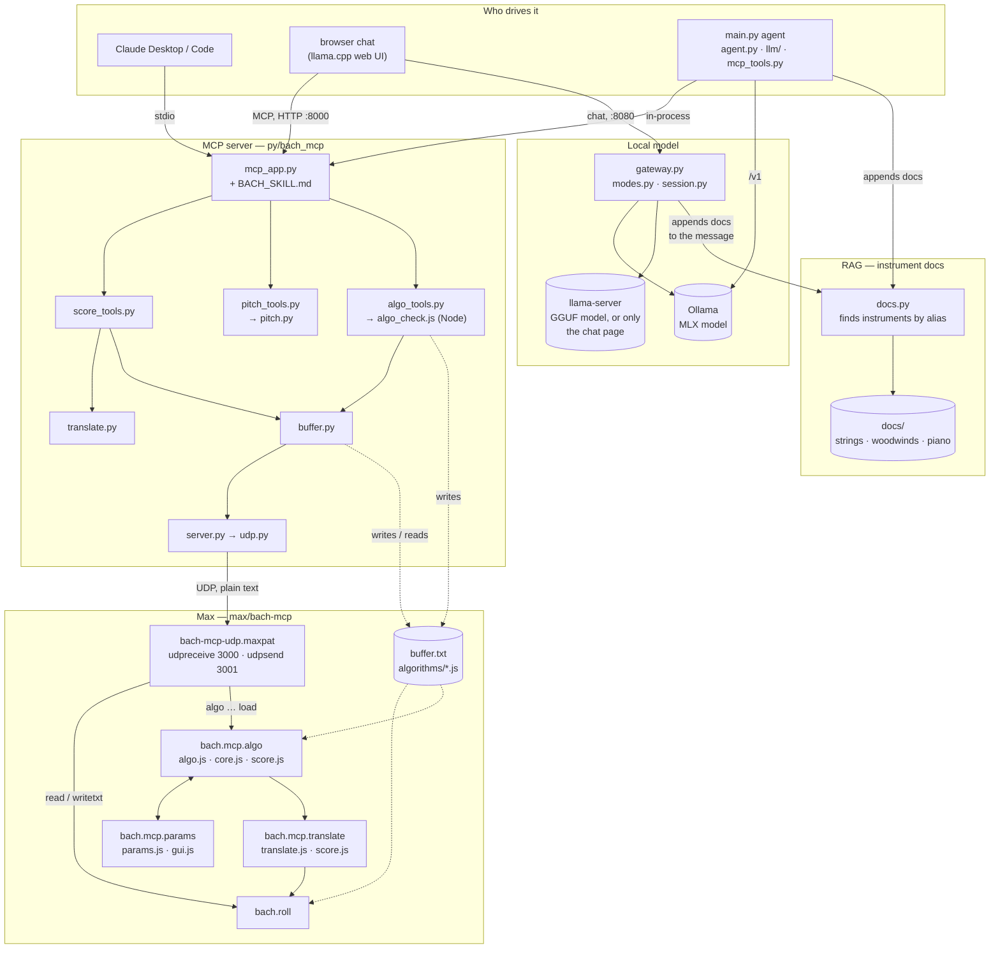

# File map

What each file in use does and how they connect. Obsolete files are in
[`deprecated/`](deprecated/README.md).

There are two ways in, and both reach the same MCP tools:

- **Claude as an MCP host** (Claude Desktop, Claude Code): launches
  `main.py serve --stdio` itself and calls the tools.
- **A local model**: `run.command` starts everything. The browser chat talks
  to the model through the gateway and to the tools over HTTP. `main.py agent`
  is the same thing in a terminal, with the tool loop in-process.

A score write goes `write_score` → `translate.py` (JSON to llll) → `buffer.py`
writes `buffer.txt` → UDP `mcp_buffer_written` → the patch sends `read` to
bach.roll. An algorithm goes `send_algorithm` → Node check → `algorithms/<name>.js`
→ UDP `algo <runner> load <path>` → `bach.mcp.algo` runs it → score dictionary →
`bach.mcp.translate` → bach.roll. Its parameters show up as a panel.

## Start and configure

| file | role |
|---|---|
| `run.command` | Double-click to start: finds the conda Python and runs `main.py run`. |
| `py/main.py` | The CLI: `run` (MCP server, gateway, model server, chat), `serve` (MCP only, HTTP or `--stdio`), `agent` (terminal chat), `eval`. |
| `bach.toml` | The only config file: model, generation, chat, MCP, llama, Ollama, Max ports, algorithms folder. |
| `py/bach_mcp/config.py` | Reads `bach.toml` (rejects unknown keys). Builds llama-server's command line and the chat's default settings. |
| `claude_desktop_config.json` | Example entry for Claude Desktop (stdio). |
| `environment.yml`, `requirements.in`, `requirements.txt` | Python 3.11 env with `mcp`, `httpx`, `requests`. |

## MCP server: the tools (the same for every host)

| file | role |
|---|---|
| `py/bach_mcp/mcp_app.py` | Builds the FastMCP app, registers the 13 tools, logs every call. `load_skill()`. |
| `py/bach_mcp/score_tools.py` | `write_score`, `read_score`, `clear_score`. Repairs a JSON score whose only mistake is its closing brackets. |
| `py/bach_mcp/pitch_tools.py` → `pitch.py` | The 9 pitch tools (`p2mc`, `get_chord`, `transpose`, …). `pitch.py` does the arithmetic and holds the chord and scale library. |
| `py/bach_mcp/algo_tools.py` → `algo_check.js` | `send_algorithm`: runs the file in Node with `bach.mcp.core.js` at every parameter edge, saves it to `algorithms/` (old version goes to `.history/`), tells Max to load it. |
| `py/bach_mcp/translate.py` | JSON ↔ llll, deterministic, no I/O. Accepts the positional and the object form. |

## Bridge to Max

| file | role |
|---|---|
| `py/bach_mcp/server.py` | `BachMCPServer`: sends over UDP and keeps a queue of incoming messages (`wait_for_incoming`, `flush_incoming`). |
| `py/bach_mcp/udp.py` | Converts between lines of text and the UDP packets `[udpreceive]` reads. |
| `py/bach_mcp/buffer.py` | Scores travel through `buffer.txt`, never as messages. Inserts chords into bach's own text for `add=True`. |

## What the model reads

| file | role |
|---|---|
| `py/bach_mcp/BACH_SKILL.md` | The skill (system prompt / MCP instructions), split into parts by `<!-- algo -->`, `<!-- score -->` and `<!-- both -->`. |
| `py/bach_mcp/modes.py` | `/score` and `/algo`: which part of the skill and which tools each request gets. |
| `py/bach_mcp/session.py` | Counts conversations, so `read_score` forgets its last answer when a new chat starts. |
| instrument docs | Retrieved per message: see the next section. |

## RAG: instrument docs

When a user message names an instrument ("a duet for cello and alto flute"),
that instrument's file and its family's file are appended to the message
before the model sees it. There's no tool call and no embeddings: matching is
by keyword, case-insensitive whole words, longest alias first, so "alto flute"
doesn't also find "flute". Each file is added once per conversation, at its
first mention. Because the result depends only on the messages, the prompt
prefix stays the same and the model server can reuse its cache. It is switched
by `docs = true` in `[chat]`.

| file | role |
|---|---|
| `py/bach_mcp/docs.py` | `DocLibrary`: reads every `docs/*/*.md` and indexes it by its `aliases`. `find()` names the files in a text, `augment()` appends them to a chat request's user messages (used by the gateway), `augment_text()` to one message (used by `main.py agent`). |
| `py/bach_mcp/docs/README.md` | The format every doc follows: front matter (`aliases`, `family`), the core before the first `##`, sections after it, sounding pitch in midicents, JSON spellings the translator accepts. |
| `py/bach_mcp/docs/strings/` | `_family.md`, violin, viola, cello, double bass. |
| `py/bach_mcp/docs/woodwinds/` | `_family.md`, piccolo, flute, alto flute, oboe, English horn, clarinet, E♭ clarinet, bass clarinet, bassoon, contrabassoon. |
| `py/bach_mcp/docs/keyboards/` | piano. |
| `py/tests/test_docs.py` | Checks every doc's fields, ranges and clefs, and that its JSON spellings are ones the translator accepts. |

Called from `gateway.py` (web chat, both backends) and `main.py agent`. Claude
as an MCP host doesn't get the docs (see Diagnosis 5).

## Local model path

| file | role |
|---|---|
| `py/bach_mcp/gateway.py` | Sits on the chat port. Applies the mode and the instrument docs (RAG), then translates to Ollama's `/api/chat` (Ollama backend) or passes through to llama-server (llama backend). |
| `py/bach_mcp/agent.py` | The tool loop of `main.py agent`. |
| `py/bach_mcp/mcp_tools.py` | Hands the MCP app's tools to `agent.py` in-process. |
| `py/bach_mcp/llm/provider.py`, `llm/openai_compat.py` | The provider interface and its one implementation, an OpenAI-compatible client (Ollama, llama.cpp, MLX, vLLM, …). |
| `py/bach_mcp/evaluate.py` | `main.py eval`: fixed requests sent to the model several times, with automatic checks. |

## Max package (`max/bach-mcp`)

| file | role |
|---|---|
| `patchers/bach-mcp-udp.maxpat` | Main patch: UDP bridge, buffer read/write, bach.roll, two runners with panels. |
| `patchers/bach-mcp-udp-danielle.maxpat` | Working patch with three runners. |
| `patchers/bach.mcp.algo.maxpat` | Runner abstraction: v8 runner, translator and (since 10-22) its own UDP bridge. |
| `patchers/bach.mcp.translate.maxpat` | Translator abstraction (`@in json\|bach @out bach\|json`). |
| `javascript/bach.mcp.algo.js` | The runner (v8): loads, runs and reloads an algorithm, keeps a transformer's source. |
| `javascript/bach.mcp.core.js` | The library every algorithm sees, plus the loader. `algo_check.js` uses it in Node. |
| `javascript/bach.mcp.score.js` | JSON ↔ llll in JavaScript, a port of `translate.py`. |
| `javascript/bach.mcp.translate.js` | The v8 script of `bach.mcp.translate`. |
| `javascript/bach.mcp.params.js`, `bach.mcp.gui.js` | The panel (jsui, ES5) and its widget library. |
| `algorithms/` | Output of `send_algorithm`: `<name>.js` and `<name>.source.txt`. `examples/` holds the algorithms the skill and tests use, `temp/` older ones, `.history/` backups (not in git). |
| `rolls/` | Test scores in bach text. |
| `buffer.txt` | The exchange file (not in git). |

## Tests (`py/tests`)

`python -m unittest discover -s py/tests` runs everything, including
`js/*.test.js` (the Max objects, in Node on the mock `maxmock.js`). There is
one file per module: translate, buffer, algo, modes, gateway, docs, pitch,
session, evaluate.

## Diagnosis (2026-10-23)

Found in this survey and not fixed yet:

1. **`clear` and `tonedivision` never reach bach.roll.** In all three patches,
   `[route algo mcp_buffer_written write_buffer]` leaves its last outlet
   unconnected. `clear_score` still answers "Score cleared.", and a
   microtonal `write_score` loses its `tonedivision`.
2. **`send_algorithm` never gets its confirmation.** The runner's
   `algo_status` goes to `[s bach.mcp.tcp]`, and nothing has received that
   since the Node bridge was removed. Every call waits 6 s, then reports "Max
   did not confirm".
3. **The bridge is in two places, and runners have no names.** `udpreceive
   3000`, `write_and_check` and `udpsend 3001` are in the main patch *and* in
   every `bach.mcp.algo`. Every runner is unnamed (`algo`), so every runner
   loads every algorithm. This is the subject of the next step (named
   runners).
4. **Ollama-only code**, which goes when MLX replaces Ollama:
   `gateway.create_gateway_app` (with `to_ollama_messages`,
   `build_ollama_request`, `keep_alive`, the loop retry),
   `main._ensure_ollama` / `_ollama_capabilities`, `[ollama]` in the config,
   and all of `evaluate.py`. With Ollama, llama-server runs only to serve the
   chat page.
5. **The two paths get different things.** Claude gets the whole skill and all
   13 tools, with no modes and no instrument docs: modes and docs are added
   only by the gateway and the agent.
6. **Too many intermediaries on the local path:** one Python process (MCP over
   HTTP plus the gateway), llama-server (the chat page), Ollama (the model)
   and Max. That is four processes and three HTTP hops before a token reaches
   the model.
7. `server.py` still parses TCP-era JSON envelopes and llll in
   `_parse_incoming`, and nothing reads the message types it assigns.

Done in this pass: obsolete files moved to `deprecated/`; the `full` tool set
and the `toolset` option removed; the example algorithms moved to
`algorithms/examples/` (fixes the 2 failing tests); unused methods removed
from `server.py`; `.gitignore` now covers the current `.history/` path.
